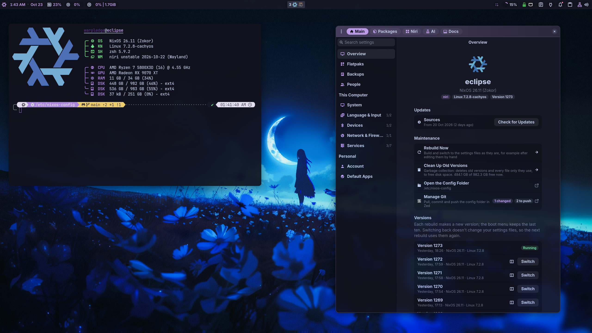
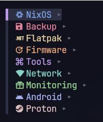
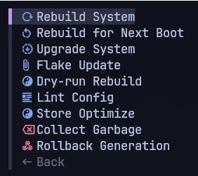

# Warpledge's NixOS Configuration

The NixOS configuration behind my desktop and laptop, both daily driven since 2022.

## Contents

- [Host Machines](#host-machines)
- [Use It on Your Machine](#use-it-on-your-machine)
- [Screenshots](#screenshots)
- [Theming](#theming)
- [System Management TUI Script](#system-management-tui-script)
- [Components](#components)
- [Shell Shortcuts](#shell-shortcuts)
- [Keybinds](#keybinds)
- [Structure](#structure)
- [Flake Inputs](#flake-inputs)

## Host Machines

- **Desktop:** Ryzen 5800X3D + RX 9070 XT (AMD-only), 280Hz OLED + 144Hz secondary
- **Laptop:** Legion Slim 5, Ryzen 7735HS + hybrid AMD 680M / RTX 4070, 1600p@165Hz

## Use It on Your Machine

Install NixOS first. The graphical installer works, disk encryption included, as long as the computer boots with UEFI. Then, logged in as the account the installer made, paste this into a terminal (it stops if the clone fails):

```bash
nix-shell -p git --run "git clone https://github.com/Warpledge/nixos-config ~/nixos-config" && cd ~/nixos-config && ./setup.sh
```

`setup.sh` asks what to call the computer and who will use it, copies `machines/_template` and `users/_template` into a folder for each, and fills them in: the hardware config, the time zone, language and keyboard picked in the installer, drivers for the graphics card it finds, and the lines an encrypted disk needs to unlock. Everyone starts with Zen, kitty, Helix, Zed, Nautilus, yazi, mpv, Steam and NixOS Settings and picks extras from a list. The new files are staged with git, since a flake ignores untracked files. The repo then moves to `/etc/nixos-config`, where every admin on the computer can edit it (`~/nixos-config` stays as a link), and the system is built to start on the next boot.

Afterwards:

- **Apps:** each person's `users/<name>/settings.nix`, then `nixm rebuild`
- **Services and hardware:** the machine's `machines/<name>/settings.nix` and `default.nix`
- **Another person:** `./setup.sh add-user`
- **Reinstalling a machine already in the repo:** run `./setup.sh` and pick it; it keeps the machine's settings and takes the new install's disks
- **A clone set up before the move:** `./setup.sh share` moves it to `/etc/nixos-config`
- **Every setting:** listed with a comment in the two `_template/settings.nix` files; anything your copy leaves out is off

## Screenshots

**Niri WM**



## Theming

Two tools split the job:

- **[Stylix][stylix]:** It takes the color scheme, the fonts and the mouse cursor and pushes them into every program that it supports automatically.
- **[catppuccin/nix][catppuccin-nix]:** Some programs have an official Catppuccin port written by the Catppuccin project. I typically use this as a higher priority than Stylix in most cases because Base16 can be a bit limiting compared to an official Catppuccin port.

## System Management TUI Script



The top level is a set of categories. Pick one and it opens into its own menu of sub-commands that I use often.



`nixm` is the script I use to manage the system day to day (it lives in [`modules/home/nixm.nix`](./modules/home/nixm.nix)).

<details>
<summary>📋 All nixm commands</summary>

#### NixOS Operations

| Command | Description |
| --- | --- |
| `nixm rebuild` | Apply the current config (`nh os switch`) |
| `nixm boot` | Build the config and apply it on next boot (`nh os boot`) |
| `nixm upgrade` | Update all flake inputs and rebuild |
| `nixm flake-update` | Update flake inputs without rebuilding |
| `nixm dryrun` | Preview what a rebuild would change |
| `nixm gc` | Garbage collect, keeping last 5 generations |
| `nixm optimize` | Hardlink identical files in the Nix store |
| `nixm rollback` | Switch to a previous system generation |
| `nixm lint` | Run `deadnix` + `statix` to check for unused args and Nix antipatterns |

#### System Monitoring

| Command | Description |
| --- | --- |
| `nixm monitor` | Resource monitor (btop) |
| `nixm disk` | Interactive disk usage (ncdu) |
| `nixm health` | Show running and failed systemd services |
| `nixm temps` | Temperature readout (lm_sensors) |

#### Network

| Command | Description |
| --- | --- |
| `nixm network` | NetworkManager TUI (nmtui) |
| `nixm speedtest` | Internet speed test |
| `nixm ping` | Quick connectivity check (ping 8.8.8.8) |

#### Flatpak

| Command | Description |
| --- | --- |
| `nixm flatpak-update` | Update all Flatpaks |
| `nixm flatpak-list` | List installed Flatpak apps |

#### Firmware

| Command | Description |
| --- | --- |
| `nixm firmware-check` | Check for available firmware updates (fwupd) |
| `nixm firmware-update` | Install firmware updates |
| `nixm firmware-devices` | List devices with firmware support |

#### Backup

Each run drops a `YYYY-MM-DD_HH-MM-SS` folder into `~/SyncBackups/<hostname>/FreeTube` and `~/SyncBackups/<hostname>/Zen`, and the 10 most recent runs of each are kept. Each host gets its own folder so [Syncthing][syncthing] can share `~/SyncBackups` between machines without one pruning the other's runs. The FreeTube files use its own Export format, so Settings → Data Settings → Import reads them straight back; close FreeTube first, since it rewrites its databases on exit. The Zen folder holds only a `bookmarks.html`, the standard bookmark file that any browser can import (Zen and Firefox included), with folders intact.

| Command | Description |
| --- | --- |
| `nixm backup` | Run both backups below with one shared timestamp |
| `nixm freetube-backup` | Export FreeTube subscriptions, playlists and watch history |
| `nixm zen-backup` | Export Zen's bookmarks as an HTML file any browser imports |

#### Tools

| Command | Description |
| --- | --- |
| `nixm vulkan` | Print Vulkan capabilities (vulkaninfo) |

#### Android

| Command | Description |
| --- | --- |
| `nixm adb-devices` | List attached adb devices |
| `nixm vpn-list` | Show the VPN lockdown allowlist on a connected phone or tablet |
| `nixm vpn-edit` | Edit that allowlist in `$EDITOR`, applies after the device reboots |
| `nixm debloater` | Launch Universal Android Debloater |

#### Proton

| Command | Description |
| --- | --- |
| `nixm launch-params` | Pick a game launch option (the `nix-vn` and `nix-rpgm` presets and other wrappers) and copy it to the clipboard |

</details>

## Components

Most of what's below is optional: apps are switched on per person in `users/<name>/settings.nix`, services per machine in `machines/<name>/settings.nix`.

<details>
<summary>🖥️ Desktop Environment</summary>

| | |
| --- | --- |
| **Window Manager** | [Niri][niri] / [Hyprland][hyprland] |
| **Status Bar / Notifier / Launcher / Lock** | [DankMaterialShell][dms] |
| **Display Manager** | [dms-greeter][dms-greeter] via [greetd][greetd] |
| **Color Scheme** | [Catppuccin][catppuccin] Mocha Mauve applied globally via [Stylix][stylix] + [catppuccin/nix][catppuccin-nix] |
| **Fonts** | [JetBrains Mono Nerd Font][nerd-fonts], Monaspace, Roboto, Nerd Fonts Symbols |
| **Window Switcher** | Niri's built-in recent-windows switcher |
| **Scratchpad** | [nirius][nirius] (Niri only) |
</details>

<details>
<summary>💻 Shell & Terminal</summary>

| | |
| --- | --- |
| **Shell** | [Zsh][zsh] with the [Powerlevel10k][p10k] prompt ([Starship][starship] is configured too, but zsh doesn't load it), plus [atuin][atuin], [fzf][fzf], [zoxide][zoxide], [eza][eza], and [direnv][direnv] with [nix-direnv][nix-direnv] for per-project dev shells |
| **Terminal Emulator** | [Kitty][kitty] / [Ghostty][ghostty] (off by default) |
| **Terminal Multiplexer** | [tmux][tmux] (run many terminals in one window) |
| **Quick Run** | `run <pkg>`: try a package one time without installing it (`nix run` wrapper). `, <cmd>` ([comma][comma]) does the same by command name, and typing a command that isn't installed prints the package that has it ([nix-index-database][nix-index-database]) |
</details>

<details>
<summary>🛠️ Development</summary>

| | |
| --- | --- |
| **Editors / IDE** | [Zed][zed], [Helix][helix], [micro][micro] (quick edits) |
| **Formatter** | [alejandra][alejandra] v3.0.0 |
| **Rebuild Wrapper** | [`nixm`](./modules/home/nixm.nix) (fzf menu over [nh][nh]) |
</details>

<details>
<summary>📦 Applications</summary>

| | |
| --- | --- |
| **Browsers** | [Zen][zen] / [Mullvad Browser][mullvad-browser] / [Helium][helium] |
| **File Manager** | [Nautilus][nautilus] (with an open-in-Kitty menu entry from [nautilus-open-any-terminal][nautilus-open-any-terminal]), [Dolphin][dolphin] (optional, themed through Kvantum and the Catppuccin KDE colour scheme, with [Ark][ark] for archives), [Yazi][yazi] (terminal file manager) |
| **Media Player** | [mpv][mpv], [Spotify][spotify] via [spicetify-nix][spicetify], [FreeTube][freetube] |
| **Twitch** | [Streamlink Twitch GUI][streamlink-twitch-gui] browses Twitch and hands the stream to [Streamlink][streamlink], which plays it in mpv, so there are no ads and the follow list stays local with no Twitch account attached; wrapped from the upstream AppImage with `appimageTools`, since it is not in nixpkgs |
| **Screenshot / Recording** | [Quick Capture][quick-capture] (Niri, Hyprland), [gpu-screen-recorder][gpu-screen-recorder] |
| **Clipboard** | [ClipBoard+][clipboard-plus] (Niri) |
| **Wallpaper Picker** | [Wallpaper Carousel][wallpaper-carousel] over the images in `modules/theme/wallpapers` (Niri), the default; each user picks it or Wallpaper Engine with `wallpaper` in their settings |
| **Animated Wallpaper** | [linux-wallpaperengine][linux-wallpaperengine] plays Wallpaper Engine scenes and videos from the Steam Workshop, in place of DMS's wallpaper; the [Linux Wallpaper Engine][dms-wallpaperengine] DMS plugin picks them (Niri, `wallpaper = "engine"`; needs Wallpaper Engine bought on Steam) |
| **Graphics** | [Blender][blender], [Krita][krita], [Affinity Suite v3][affinity-nix] (via Wine), all off by default |
| **Audio** | [Reaper][reaper] (DAW, with [SWS][sws] and [ReaPack][reapack]) |
| **Guitar** | [TONE3000][tone3000] (official NAM player, browses its capture and IR library in-app), [Guitarix][guitarix] (modular amp rig), [ir.lv2][ir-lv2] for cabinet IRs, [qpwgraph][qpwgraph] for patching, plus [FxFloorBoard][katana-fxfloorboard] to edit patches on the Boss Katana itself |
| **Rhythm Games** | [feedBack][feedback] plays Guitar Pro tabs through its own audio engine, with VST hosting and amp modeling, so the Katana DI feed doubles as the game input; wrapped from the upstream AppImage with `appimageTools`, since it is not in nixpkgs. [Rocksmith 2014][rocksmith] runs on Proton and reads the same DI through [PipeASIO][pipeasio] and [RS_ASIO][rs-asio]; the module writes their config, and the hand-done install steps live in `docs/gaming/rocksmith-2014.md` |
| **Chat / Productivity** | [GoofCord][goofcord] via [nixcord][nixcord] (Vencord, with [arRPC][arrpc] running alongside it so Steam and Proton games show up as rich presence), [Ferdium][ferdium] (all your web messengers in one window), [Thunderbird][thunderbird], [Obsidian][obsidian] |
| **AI Tooling** | [Claude Code][claude-code], [Claude Desktop][claude-desktop], [OpenCode][opencode], [LM Studio][lmstudio], [llama-swap][llama-swap] |
| **Android** | [scrcpy][scrcpy] (mirror and control a device over USB or wifi, nothing to install on the phone) |
| **Video Trimming** | [Video Trimmer][video-trimmer] (cut a clip out of a video without re-encoding it), [Constrict][constrict] (re-encode a video to fit a chosen file size) |
| **Manga / Anime Reader** | [Suwayomi][suwayomi] is a local manga reader, opened from the launcher as a [Helium][helium] app window (`localhost:4567`) after a password prompt. [Moku][moku] covers manga, light novels and anime, built from source with a fix for overlapping search results, a per-source filter panel and a button that opens the current episode in mpv, with a local [FlareSolverr][flaresolverr] for Cloudflare-protected sources |
| **Image Boards** | [Boorusama][boorusama] browses booru sites; it's the desktop build of the Android client, wrapped from the upstream AppImage with `appimageTools` since it is not in nixpkgs. Its data, cache and backups sit in a [gocryptfs][gocryptfs] vault that the launcher unlocks with a password and locks again on exit |
| **Finance** | [HomeBank][homebank] (personal accounting with labeled transactions and a running balance) |
| **Collection Tracking** | [Tonkatsu Box][tonkatsu-box] (games, film, anime, manga, visual novels, books and music in one local database, imports from Steam and AniList; a prebuilt bundle kept in `~/.local/opt/` instead of nixpkgs) |
| **Task Manager** | [Resources][resources] (system and process monitor) |
| **Settings App** | NixOS Settings ([`modules/home/programs/system/nixos-settings/`](./modules/home/programs/system/nixos-settings/)), a GTK window over the settings files: switch apps on or off and pick the kernel, window manager, services, firewall ports, language and keyboard from menus, with a search box that also finds DankMaterialShell's settings and buttons that open the shell's own pages (monitors, shortcuts, mouse and touchpad, theme). Apply writes the files, checks them and rebuilds through a [polkit][polkit] helper, on a page that shows the downloads and builds as they run, what changed and which services restarted, with an undo if anything fails. Apply can also preview: it builds and shows what would change without switching. Its Overview checks for updates and installs all of them or the ones you tick, switches back to an earlier version, cleans up old versions with an estimate of the space freed, shows the config's git state and keeps the last failed run's log. Tabs across the top of the window split the sidebar into Main, Niri, Servers and Docs; under niri, the Niri tab also holds the desktop shell's pages and its shortcut buttons. Niri's Window Rules page makes a rule for a window you click or pick from a list (floating, size, workspace, opacity, hidden from screen capture and more) and lists every rule niri has, grouped by what it does, with each rule's effects as coloured tags and an edit and remove button. Servers starts, stops and follows the Minecraft servers and shows each modpack's notes; Docs has Proton's launch options (copied with a click) and installed Proton versions, and the game notes from `docs/gaming/`. Main also has a Flatpaks page that turns Flatpak on or off and updates, repairs and removes Flatpak apps, a Backups page for FreeTube and Zen, a People page where an admin adds a person with their first password, and which services are running on the Services page. Each person changes only their own apps; only admins change the computer-wide settings, update or switch versions |
| **Japanese** | [fcitx5][fcitx5] + [Mozc][mozc] for typing hiragana, katakana and kanji, plus [innoextract][innoextract], [cabextract][cabextract] and [mdf2iso][mdf2iso] for unpacking raw Japanese visual novels (off by default) |
</details>

<details>
<summary>🎮 Gaming</summary>

| | |
| --- | --- |
| **Launchers** | [Steam][steam] ([Gamescope][gamescope]), [Heroic][heroic], [Prism Launcher][prismlauncher], [Hytale][hytale] (a Flatpak, installed by hand), [EasyRPG Player][easyrpg] (RPG Maker 2000/2003 games, plus a Tobira no Densetsu launcher upscaled in gamescope), [xsystem4][xsystem4] (System 4 engine games), [Faugus Launcher][faugus-launcher], plus [Twintail][twintail] (gacha games) and [Lutris][lutris], those two off by default |
| **Tools** | [GameMode][gamemode], [MangoHud][mangohud], [Goverlay][goverlay], [r2modman][r2modman], [ProtonPlus][protonplus], [Satisfactory Mod Manager][smm], [AntimicroX][antimicrox], [Rusty PoB][rpob], [Ludusavi][ludusavi] (daily game save backups), [RetroShelf][retroshelf] (ES-DE / RetroDECK library tidier) |
| **Game Streaming** | [Sunshine][sunshine] streams games to [Moonlight][moonlight] clients on the LAN (off by default) |
| **Granblue Relink Mods** | [RelinkModOrganizer][rmo] for data mods and [Reloaded-II][reloaded-ii] for code mods, both prebuilt bundles kept out of nixpkgs: RelinkModOrganizer in `~/.local/opt/`, Reloaded-II in the Desktop folder its installer makes, run in the game's Proton prefix (off by default) |
</details>

<details>
<summary>⚙️ System</summary>

| | |
| --- | --- |
| **Audio** | [PipeWire][pipewire] (ALSA + PulseAudio compat) |
| **Containers** | [Docker][docker], off by default |
| **Flatpak** | [nix-flatpak][nix-flatpak] (declarative Flatpak management) with [Flatseal][flatseal] for app permissions, when the machine's `flatpak.enable` is on |
| **Networking** | [systemd-resolved][resolved] + [NetworkManager][networkmanager] (iwd), and [Mullvad][mullvad] over WireGuard with multihop, [DAITA][daita] and a kill switch that blocks traffic while the tunnel is down |
| **Key Remapping** | [keyd][keyd] makes Caps Lock Escape on tap and Ctrl on hold (`capsLockRemap`) |
| **Bluetooth** | [BlueZ][bluez], per machine (`bluetooth.enable`) |
| **Printing** | [CUPS][cups], with [Avahi][avahi] finding network printers (`printing.enable`, off by default) |
| **GPU Tuning** | [LACT][lact] for the desktop's RX 9070 XT, with amdgpu overdrive on so it can undervolt |
| **Bootloader** | [systemd-boot][systemd-boot] |
| **Kernel** | [CachyOS kernel][cachyos-kernel] (selectable: zen / latest / xanmod / cachyos), with the [scx_lavd][scx] sched_ext scheduler |
</details>

<details>
<summary>🔒 Security & Privacy</summary>

| | |
| --- | --- |
| **Disk** | ext4 on a [LUKS][luks]-encrypted partition, unlocked at boot |
| **Access Control** | [AppArmor][apparmor] profiles for the apps that open untrusted files or run third-party code (mpv, yt-dlp, streamlink, Evince, File Roller, Ark, unrar, Obsidian, Prism Launcher, Moku's Tsunagu backend, and the prebuilt Tonkatsu Box and Katana FloorBoard bundles), limiting each to the files it needs. They run in log-only mode for now. Crash dumps are switched off so a crash cannot spill memory contents to disk |
| **Kernel Hardening** | Boot settings that make the system harder to attack: the core of the OS refuses to be modified while running, memory is placed unpredictably so an attacker cannot count on where things are, kernel memory is zeroed before it's handed out, and io_uring, a kernel interface behind many recent exploits, is switched off |
| **Network Hardening** | The usual anti-spoofing settings: packets claiming to come from an address they cannot have come from get dropped, requests to reroute traffic are ignored, and the machine stays up under a basic flood attack |
| **Auditing** | [auditd][auditd], with a daily timer to keep the log from growing forever |
| **Hosts Blocklists** | [StevenBlack][stevenblack] (the base ads and malware list, plus the categories a machine's `blocklist.extra` names, fake news and gambling on both), from the nixpkgs package |
| **Browser** | [Zen][zen] with [Arkenfox][arkenfox] and [Securefox][securefox] tweaks, plus [Mullvad Browser][mullvad-browser] |
| **Secrets** | [GNOME Keyring][gnome-keyring] |
| **Passwords** | [KeePassXC][keepassxc], with the vault file synced between devices by [Syncthing][syncthing] |
| **Antivirus** | [ClamAV][clamav] (off by default) |
| **Remote Access** | [OpenSSH][openssh] with key-only login and no root login, plus [fail2ban][fail2ban], which bans an address for 12 hours after 3 failed attempts (off by default) |
| **Cleanup** | [BleachBit][bleachbit] clears caches, logs and browser leftovers when run by hand; nothing runs on a schedule |

</details>

[niri]: https://github.com/YaLTeR/niri
[hyprland]: https://hyprland.org
[dms]: https://github.com/AvengeMedia/DankMaterialShell
[dms-greeter]: https://github.com/AvengeMedia/dank-greeter
[greetd]: https://git.sr.ht/~kennylevinsen/greetd
[catppuccin]: https://github.com/catppuccin/catppuccin
[catppuccin-nix]: https://github.com/catppuccin/nix
[stylix]: https://github.com/nix-community/stylix
[nerd-fonts]: https://www.nerdfonts.com
[zsh]: https://www.zsh.org
[p10k]: https://github.com/romkatv/powerlevel10k
[starship]: https://starship.rs
[atuin]: https://atuin.sh
[fzf]: https://github.com/junegunn/fzf
[zoxide]: https://github.com/ajeetdsouza/zoxide
[eza]: https://github.com/eza-community/eza
[direnv]: https://direnv.net
[nix-direnv]: https://github.com/nix-community/nix-direnv
[comma]: https://github.com/nix-community/comma
[nix-index-database]: https://github.com/nix-community/nix-index-database
[kitty]: https://sw.kovidgoyal.net/kitty
[ghostty]: https://ghostty.org
[tmux]: https://github.com/tmux/tmux
[zed]: https://zed.dev
[helix]: https://helix-editor.com
[micro]: https://micro-editor.github.io
[zen]: https://zen-browser.app
[mullvad-browser]: https://mullvad.net/en/browser
[helium]: https://github.com/schembriaiden/helium-browser-nix-flake
[ark]: https://invent.kde.org/utilities/ark
[dolphin]: https://invent.kde.org/system/dolphin
[nautilus]: https://apps.gnome.org/Nautilus
[nautilus-open-any-terminal]: https://github.com/Stunkymonkey/nautilus-open-any-terminal
[mpv]: https://mpv.io
[spotify]: https://www.spotify.com
[spicetify]: https://github.com/Gerg-L/spicetify-nix
[freetube]: https://freetubeapp.io
[gpu-screen-recorder]: https://git.dec05eba.com/gpu-screen-recorder
[quick-capture]: https://github.com/hthienloc/dms-plugins
[clipboard-plus]: https://github.com/Dadangdut33/dms-plugins
[wallpaper-carousel]: https://github.com/motor-dev/wallpaperCarousel
[linux-wallpaperengine]: https://github.com/Almamu/linux-wallpaperengine
[dms-wallpaperengine]: https://github.com/sgtaziz/dms-wallpaperengine
[blender]: https://www.blender.org
[krita]: https://krita.org
[affinity-nix]: https://github.com/mrshmllow/affinity-nix
[reaper]: https://www.reaper.fm
[sws]: https://www.sws-extension.org
[reapack]: https://reapack.com
[tone3000]: https://www.tone3000.com/plugin
[tonkatsu-box]: https://github.com/hacan359/tonkatsu_box
[guitarix]: https://guitarix.org
[ir-lv2]: https://github.com/tomszilagyi/ir.lv2
[qpwgraph]: https://gitlab.freedesktop.org/rncbc/qpwgraph
[katana-fxfloorboard]: https://github.com/gumtown/Katana-MK2-FxFloorBoard
[goofcord]: https://github.com/Milkshiift/GoofCord
[nixcord]: https://github.com/KaylorBen/nixcord
[ferdium]: https://ferdium.org
[thunderbird]: https://www.thunderbird.net
[obsidian]: https://obsidian.md
[scrcpy]: https://github.com/Genymobile/scrcpy
[yazi]: https://github.com/sxyazi/yazi
[arrpc]: https://arrpc.openasar.dev
[video-trimmer]: https://gitlab.gnome.org/YaLTeR/video-trimmer
[constrict]: https://gitlab.gnome.org/World/Constrict
[moku]: https://github.com/moku-project/Moku
[flaresolverr]: https://github.com/FlareSolverr/FlareSolverr
[suwayomi]: https://github.com/Suwayomi/Suwayomi-Server
[boorusama]: https://github.com/khoadng/Boorusama
[gocryptfs]: https://nuetzlich.net/gocryptfs/
[resources]: https://gitlab.gnome.org/GNOME/Incubator/resources
[polkit]: https://github.com/polkit-org/polkit
[streamlink-twitch-gui]: https://github.com/streamlink/streamlink-twitch-gui
[feedback]: https://github.com/got-feedBack/feedBack-desktop
[rocksmith]: https://store.steampowered.com/app/221680/
[pipeasio]: https://github.com/M0n7y5/pipeasio
[rs-asio]: https://github.com/mdias/rs_asio
[streamlink]: https://streamlink.github.io/
[homebank]: https://www.gethomebank.org
[fcitx5]: https://github.com/fcitx/fcitx5
[mozc]: https://github.com/fcitx/mozc
[innoextract]: https://constexpr.org/innoextract
[cabextract]: https://www.cabextract.org.uk
[mdf2iso]: https://salsa.debian.org/debian/mdf2iso
[steam]: https://store.steampowered.com
[heroic]: https://heroicgameslauncher.com
[prismlauncher]: https://prismlauncher.org
[faugus-launcher]: https://github.com/Faugus/faugus-launcher
[gamemode]: https://github.com/FeralInteractive/gamemode
[mangohud]: https://github.com/flightlessmango/MangoHud
[goverlay]: https://github.com/benjamimgois/goverlay
[r2modman]: https://github.com/ebkr/r2modmanPlus
[protonplus]: https://github.com/vysp3r/proton-plus
[smm]: https://github.com/satisfactorymodding/SatisfactoryModManager
[antimicrox]: https://github.com/AntiMicroX/antimicrox
[lutris]: https://lutris.net
[rpob]: https://pathofbuilding.community
[twintail]: https://github.com/TwintailTeam/TwintailLauncher
[hytale]: https://hytale.com
[easyrpg]: https://easyrpg.org/
[xsystem4]: https://github.com/nunuhara/xsystem4
[rmo]: https://github.com/RokyZevon/RelinkModOrganizer
[reloaded-ii]: https://github.com/Reloaded-Project/Reloaded-II
[ludusavi]: https://github.com/mtkennerly/ludusavi
[retroshelf]: https://github.com/votex09/retroshelf
[sunshine]: https://github.com/LizardByte/Sunshine
[moonlight]: https://moonlight-stream.org
[claude-code]: https://github.com/anthropics/claude-code
[claude-desktop]: https://code.claude.com/docs/en/desktop-linux
[opencode]: https://github.com/opencode-ai/opencode
[lmstudio]: https://lmstudio.ai
[llama-swap]: https://github.com/mostlygeek/llama-swap
[docker]: https://www.docker.com
[mullvad]: https://mullvad.net
[resolved]: https://www.freedesktop.org/software/systemd/man/systemd-resolved.html
[networkmanager]: https://networkmanager.dev
[bluez]: https://bluez.github.io/
[cups]: https://openprinting.github.io/cups/
[avahi]: http://avahi.org
[clamav]: https://www.clamav.net
[bleachbit]: https://bleachbit.sourceforge.net
[keepassxc]: https://keepassxc.org/
[syncthing]: https://syncthing.net/
[keyd]: https://github.com/rvaiya/keyd
[lact]: https://github.com/ilya-zlobintsev/LACT
[gnome-keyring]: https://wiki.gnome.org/Projects/GnomeKeyring
[luks]: https://gitlab.com/cryptsetup/cryptsetup
[systemd-boot]: https://www.freedesktop.org/software/systemd/man/systemd-boot.html
[cachyos-kernel]: https://github.com/CachyOS/linux-cachyos
[scx]: https://github.com/sched-ext/scx
[alejandra]: https://github.com/kamadorueda/alejandra
[nh]: https://github.com/nix-community/nh
[nirius]: https://git.sr.ht/~tsdh/nirius
[pipewire]: https://pipewire.org
[nix-flatpak]: https://github.com/gmodena/nix-flatpak
[flatseal]: https://github.com/tchx84/Flatseal
[apparmor]: https://apparmor.net
[auditd]: https://github.com/linux-audit/audit-userspace
[stevenblack]: https://github.com/StevenBlack/hosts
[daita]: https://mullvad.net/en/vpn/daita
[arkenfox]: https://github.com/arkenfox/user.js
[securefox]: https://github.com/yokoffing/Betterfox
[openssh]: https://www.openssh.com/
[fail2ban]: https://www.fail2ban.org/
[gamescope]: https://github.com/ValveSoftware/gamescope

## Shell Shortcuts

Short commands I use in place of longer ones, all set up in [`zsh.nix`](./modules/home/programs/shell/zsh.nix). The ones marked _(fn)_ take an argument.

<details>
<summary>⚡ All shell shortcuts</summary>

#### Editors & Files

| Shortcut | Runs |
| --- | --- |
| `v` / `vi` / `vim` | `hx` ([Helix][helix]) |
| `nano` | `micro` |
| `zed` | `zeditor` |
| `cat` | `bat` |
| `ls` / `l` / `ll` | `eza` |
| `tree` | `eza --tree` |
| `y` | `yazi` |
| `open <file>` | `xdg-open` |

#### Navigation

| Shortcut | Runs |
| --- | --- |
| `temp` | `cd /tmp` |
| `cdnix` | open the config (`flakePath`) in Zed |

#### Git

| Shortcut | Runs |
| --- | --- |
| `g` | `lazygit` |
| `ga` | `git add` |
| `gc` / `gcm` | `git commit` / `git commit -m` |
| `gcu` | `git add . && git commit -m 'Update'` |
| `gp` / `gpl` | `git push` / `git pull` |
| `gs` / `gd` | `git status` / `git diff` |
| `gco` / `gcb` | `git checkout` / `git checkout -b` |
| `gbr` | `git branch` |

#### Nix

| Shortcut | Runs |
| --- | --- |
| `run <pkg>` _(fn)_ | try a package once without installing it (`nix run nixpkgs#<pkg>`) |
| `cleanup` | garbage-collect, keeping the last 5 generations |
| `listgen` | list system generations |
| `bloat` | show current system closure size |

#### System & Misc

| Shortcut | Runs |
| --- | --- |
| `c` / `e` | `clear` / `exit` |
| `us` / `rs` | `systemctl --user` / `sudo systemctl` |
| `cleanram` | drop filesystem caches |
| `fetch` | `fastfetch` |
| `anime` | `ani-cli` |
| `f` | `figlet` |

</details>

## Keybinds

`Mod` is the Super (Windows) key.

>**Note:** `Mod+/` opens a keybind overlay cheatsheet in both WMs.

<details>
<summary>⌨️ Niri Keybinds</summary>

#### Apps

| Keybind | Action |
| --- | --- |
| `Mod+Return` | Terminal (Kitty) |
| `Mod+Z` | Code editor (Zed) |
| `Mod+B` | Browser (Zen) |
| `Mod+E` | File manager (Nautilus, or Dolphin when it's the default) |
| `Mod+Shift+S` | Steam |
| `Mod+Shift+D` | Discord (GoofCord) |
| `Mod+Shift+H` | Heroic |
| `Mod+Shift+G` | Lutris (only while it's turned on) |
| `Mod+Shift+M` | Spotify |
| `Mod+Shift+Y` | FreeTube |
| `Mod+C` | NixOS Settings (focuses it when already open) |
| `Ctrl+Alt+Delete` | Task manager (Resources) |

#### Shell (DankMaterialShell)

| Keybind | Action |
| --- | --- |
| `Mod+A` | App launcher (spotlight) |
| `Mod+V` | Clipboard history |
| `Mod+P` | Task manager |
| `Mod+N` | Notepad |
| `Mod+Comma` | DMS settings |
| `Mod+K` | Power menu |
| `Mod+L` | Lock screen |
| `Mod+I` | Toggle idle inhibit (keep the screen awake) |
| `Mod+W` | Browse wallpapers |
| `Mod+Shift+N` | Toggle night mode |
| `Mod+/` | Keybind cheatsheet |
| `Mod+R` | Restart DMS |

#### Window Management

| Keybind | Action |
| --- | --- |
| `Mod+Q` | Close window |
| `Mod+Space` | Toggle floating |
| `Mod+Shift+Space` | Switch focus between floating and tiled windows |
| `Mod+Shift+T` | Turn the window's opacity rule off and on |
| `Mod+Y` | Same, and makes apps without an opacity rule (Zen) translucent too |
| `Mod+T` | Cycle blur presets (Subtle, Default, Clear) |
| `Mod+Escape` | Take shortcuts back from an app that inhibits them |
| `Mod+F` | Maximize column |
| `Mod+Shift+F` | Fullscreen |
| `Mod+Tab` | Toggle overview |
| `Mod+H` | Center column |
| `Mod+S` | Cycle column width presets |
| `Mod+D` | Expand column to available width |
| `Mod+X` | Cycle window height presets |
| `Mod+Shift+Z` | Reset window height |
| `Mod+G` | Maximize window to screen edges |
| `Mod+[` / `Mod+]` | Pull the window on the left/right into this column, or push this one out |
| `Mod+\` | Toggle tabs for the column |

#### Focus & Movement

| Keybind | Action |
| --- | --- |
| `Mod+←/→` | Focus column left/right |
| `Mod+↑/↓` | Focus the window above/below in the column, then the workspace above/below |
| `Mod+Shift+←/→` | Move column left/right |
| `Mod+Shift+↑/↓` | Move the window up/down in its column, then to the workspace above/below |
| `Mod+Alt+←/→` | Focus monitor left/right |
| `Mod+Alt+Shift+←/→` | Move column to the monitor left/right |
| `Mod+Scroll` | Focus column left/right |
| `Mod+Shift+Scroll` | Focus workspace up/down |

#### Resize

| Keybind | Action |
| --- | --- |
| `Mod+Ctrl+←/→` | Resize column ±80px |
| `Mod+Ctrl+↑/↓` | Resize window height ±80px |
| `Mod+−/+` | Resize column width ±10% |
| `Mod+Shift+−/+` | Resize window height ±10% |
| `Mod+Alt+1/2/3` | Set column width 33% / 50% / 66% |

#### Workspaces

| Keybind | Action |
| --- | --- |
| `Mod+1–9` | Focus workspace N (desktop: 1–6 on the main monitor, 7–9 on the second; Steam opens on 6, Spotify on 8, GoofCord on 9) |
| `Mod+Shift+1–9` | Move window to workspace N |
| `Mod+0` | Show / hide the scratchpad windows over the current workspace (nirius) |
| `Mod+Shift+0` | Move window to / out of the scratchpad (nirius) |

#### Media & Capture

| Keybind | Action |
| --- | --- |
| `Print` | Region screenshot (Quick Capture, opens its editor) |
| `Mod+Print` | Focused window screenshot |
| `Mod+Shift+Print` | Focused output screenshot |
| `Ctrl+Print` | All outputs screenshot |
| `Mod+Ctrl+Print` | Scrolling capture |
| `Mod+End` | Toggle screen recording (portal) |
| `Volume Up/Down/Mute` | Volume, routed through DMS so the on-screen indicator shows; works on the lock screen |
| `Mic Mute` | Mute the microphone; works on the lock screen |
| `Brightness Up/Down` | Screen brightness |
| `Play/Pause`, `Stop`, `Prev`, `Next` | Media controls for the player used last (playerctl); work on the lock screen |

#### Window Switcher

| Keybind | Action |
| --- | --- |
| `Alt+Tab` | Recent windows switcher; `Shift` goes back, `S` narrows it to the workspace or monitor |
| `Alt+Tilde` | The same switcher, limited to the focused app's windows |

</details>

<details>
<summary>⌨️ Hyprland Keybinds</summary>

#### Apps

| Keybind | Action |
| --- | --- |
| `Mod+Return` | Terminal (Kitty) |
| `Mod+Z` | Code editor (Zed) |
| `Mod+B` | Browser (Zen) |
| `Mod+E` | File manager (Nautilus, or Dolphin when it's the default) |
| `Mod+Shift+S` | Steam |
| `Mod+Shift+D` | Discord (GoofCord) |
| `Mod+Shift+H` | Heroic |
| `Mod+Shift+G` | Lutris |
| `Mod+Shift+M` | Spotify |
| `Mod+Shift+Y` | FreeTube |
| `Mod+Shift+C` | NixOS Settings (focuses it when already open) |

#### Window Management

| Keybind | Action |
| --- | --- |
| `Mod+Q` | Close window |
| `Mod+Space` | Toggle floating |
| `Mod+F` | Fullscreen |
| `Mod+D` | Maximize |
| `Mod+T` | Toggle opacity |
| `Mod+H` | Toggle HDR on the main monitor |
| `Mod+0` | Toggle scratchpad |
| `Mod+Shift+0` | Move to scratchpad |

#### Shell (DankMaterialShell)

Same binds as the Niri table, `Mod+A` through `Mod+R`.

#### Focus & Movement

| Keybind | Action |
| --- | --- |
| `Mod+←/→/↑/↓` | Focus window in direction |
| `Mod+Shift+←/→/↑/↓` | Move window in direction |
| `Mod+Scroll` | Scroll through workspaces |

#### Resize & Move

| Keybind | Action |
| --- | --- |
| `Mod+Ctrl+←/→/↑/↓` | Resize window ±80px |
| `Mod+Alt+←/→/↑/↓` | Move floating window ±80px |
| `Mod+LMB drag` | Move window |
| `Mod+RMB drag` | Resize window |

#### Workspaces

| Keybind | Action |
| --- | --- |
| `Mod+1–9` | Focus workspace N |
| `Mod+Shift+1–9` | Move window to workspace N |

#### Media & Capture

| Keybind | Action |
| --- | --- |
| `Print` | Region screenshot (Quick Capture, opens its editor) |
| `Mod+Print` | Focused window screenshot |
| `Mod+Shift+Print` | Focused output screenshot |
| `Ctrl+Print` | All outputs screenshot |
| `Mod+Ctrl+Print` | Scrolling capture |
| `Mod+End` | Toggle screen recording (portal) |

</details>

## Structure

**Layout:** top-level directories and what lives in each:

```
flake.nix                         # one system per folder in machines/
setup.sh                          # sets up a new computer, or adds a person
lib/settings.nix                  # reads and checks the settings files
machines/
  ├── _template/                  # copied for a new computer
  └── {desktop,laptop}/
        ├── settings.nix          # machine toggles, and who logs in
        ├── default.nix           # machine entry
        ├── hardware/             # hardware-configuration.nix, GPU, swapfile (laptop)
        ├── wm/                   # per-machine WM settings, monitors included
        └── minecraft-servers/    # GTNH + TerraFirmaGreg servers (laptop)
users/
  ├── _template/                  # copied for a new person
  └── warpledge/                  # my apps, on every machine
modules/
  ├── default.nix                 # NixOS + one home-manager config per user
  ├── nixos/                      # system modules
  ├── home/                       # user modules
  ├── theme/                      # stylix, catppuccin, fonts, GTK, QT, DMS
  └── wm/                         # window managers
docs/                           # personal notes I share between devices
```

```
flake.nix
  → lib/settings.nix                         # Read the machine's settings and its users'
  → machines/<name>/default.nix              # Pick the machine
    → modules/default.nix                    # Wire up the system + each user's config
      → modules/{nixos,home}/                # Load only the enabled modules
      → modules/wm/${windowManager}/         # Load only the active window manager
```

## Flake Inputs

| Input | Purpose |
| --- | --- |
| [`nixpkgs`](https://github.com/NixOS/nixpkgs) (`nixos-unstable`) | Main package set |
| [`home-manager`](https://github.com/nix-community/home-manager) | User environment management |
| [`nur`](https://github.com/nix-community/NUR) | NixOS User Repository |
| [`niri`](https://github.com/epireyn/niri-flake) (epireyn/niri-flake) | Niri WM |
| [`dms`](https://github.com/AvengeMedia/DankMaterialShell) (AvengeMedia, stable) | DankMaterialShell |
| [`dms-plugin-registry`](https://github.com/AvengeMedia/dms-plugin-registry) | DankMaterialShell plugins (AI usage overview, Quick Capture, AMD GPU monitor, ClipBoard+, Wallpaper Carousel, Linux Wallpaper Engine) |
| [`dank-greeter`](https://github.com/AvengeMedia/dank-greeter) | Login screen that matches DankMaterialShell |
| [`stylix`](https://github.com/nix-community/stylix) | System-wide theming |
| [`catppuccin`](https://github.com/catppuccin/nix) | Catppuccin theme module |
| [`nixcord`](https://github.com/kaylorben/nixcord) | GoofCord / Vencord |
| [`spicetify-nix`](https://github.com/gerg-l/spicetify-nix) | Spotify theming |
| [`zen-browser`](https://github.com/0xc000022070/zen-browser-flake) | Zen Browser |
| [`helium`](https://github.com/schembriaiden/helium-browser-nix-flake) | Helium Browser |
| [`moku`](https://github.com/moku-project/Moku) (pinned release) | Moku reader for manga, light novels and anime, built from source |
| [`tsunagu`](https://github.com/moku-project/Tsunagu) (pinned release) | Moku's extension backend, bumped together with `moku` |
| [`retroshelf`](https://github.com/votex09/retroshelf) (main) | RetroShelf, built from source |
| [`cachyos-kernel`](https://github.com/xddxdd/nix-cachyos-kernel) | CachyOS kernel |
| [`nix-flatpak`](https://github.com/gmodena/nix-flatpak) | Declarative Flatpak management |
| [`claude-code`](https://github.com/sadjow/claude-code-nix) | Claude Code, packaged so it updates without waiting on nixpkgs |
| [`claude-desktop`](https://github.com/kubastick/claude-desktop-nixos) | Anthropic's Linux .deb of the Claude desktop app, patched for NixOS |
| [`nix-index-database`](https://github.com/nix-community/nix-index-database) | Prebuilt weekly nix-index database for comma and the command-not-found hint |
| [`alejandra`](https://github.com/kamadorueda/alejandra) (pinned 3.0.0) | Nix formatter |
| [`affinity-nix`](https://github.com/mrshmllow/affinity-nix) | Affinity Suite v3 (Photo, Designer, Publisher) via Wine |
